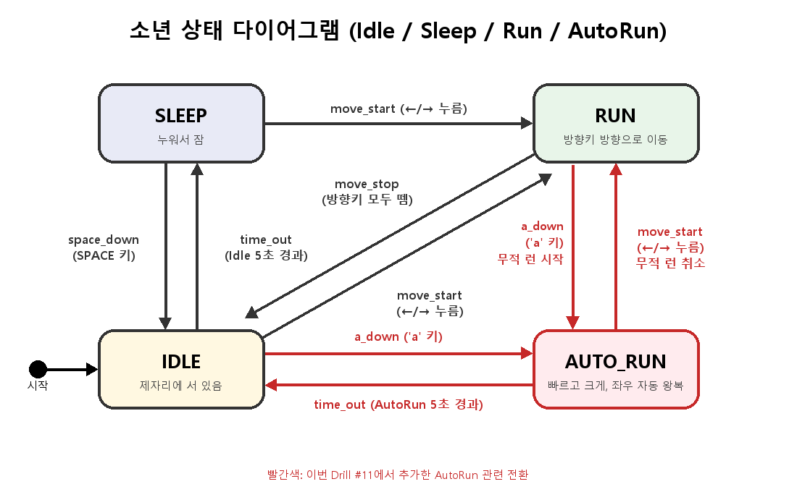

# Drill #11 — 소년 자동 무적 런(AutoRun) 상태 추가

pico2d로 만든 소년 캐릭터에 상태 머신을 구현하고 AutoRun 상태를 추가한 실습 과제입니다.
요구사항과 설계는 [PRD.md](PRD.md)에 정리되어 있습니다.

## 실행 방법

```
pip install pico2d
python main.py
```

## 조작

| 키 | 동작 |
|---|---|
| ← / → | 좌우로 달리기 (Run) |
| `a` | Idle에서 자동 무적 런 (AutoRun) |
| SPACE | 잠든 소년 깨우기 (Sleep → Idle) |
| ESC | 종료 |

## 상태 다이어그램


